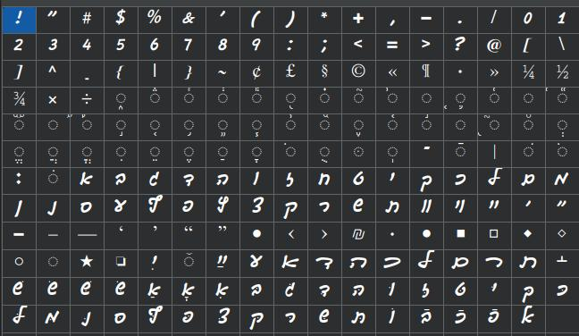

# hwocr — OCR ивритских шрифтов, имитирующих рукописное письмо

Проект-концепт для распознавания ивритского текста, набранного компьютерным шрифтом,
имитирующим рукопись. Работает полностью оффлайн, на CPU, без скачивания предобученных
моделей.

Распознаёт не идеально, особенно ошибается с пробелами, но это лучше, чем ничего.

## Образцы шрифтов

**Gveret Levin Alef Alef Alef** — `fonts/Gveret Levin Alef Alef Alef.ttf`


**Guttman Yad-Brush** — `fonts/guttman-yad-brush.ttf`



## Быстрый старт

### 1. Установить зависимости

```bash
uv sync        # или: pip install -r requirements.txt
```

### 2. Скачать файлы моделей

Скачать все 8 файлов и поместить их в каталог `models` проекта
(на одном уровне с `fonts`, `hwocr` и т. д.):

1. https://drive.google.com/file/d/1AE0zWAAsLuDegk74EpGNIEX9zHilnbpW/view?usp=sharing
2. https://drive.google.com/file/d/1sIPL8GAp-XVeLjfgd-HlBV_Bhllj9Hv8/view?usp=sharing
3. https://drive.google.com/file/d/1I2O82lsYI0GRep-lBsQKg06k38nKKXfW/view?usp=sharing
4. https://drive.google.com/file/d/1PdAZGHZEsfAbEmA1_Ov3Za-a8mRAyBUP/view?usp=sharing
5. https://drive.google.com/file/d/1CFFJ_er9UPn4E_yw8aQgaDMinrD09LuF/view?usp=sharing
6. https://drive.google.com/file/d/1GCqJ0kPo2uKkFEsj-agEZqzF9W5qEUdr/view?usp=sharing
7. https://drive.google.com/file/d/1fCP4sr8q75QHcAjTEdQjcQx31n_6w4-M/view?usp=sharing
8. https://drive.google.com/file/d/1pdvnE92FRHm1e9xXfwLyo8LR5MRTP9O1/view?usp=sharing

### 3. Распознать свой файл

```bash
python3 -m hwocr.cli recognize --image page.png --out-image runs/annotated.png
```

### 4. Веб-интерфейс

Drag&drop картинок + редактор рамок + демо:

```bash
python3 -m hwocr.cli serve --port 8009     # или: bash run_server.sh
```

Затем откройте в браузере **http://127.0.0.1:8009**. Модель загружается в память при
старте, поэтому после дообучения перезапустите сервер, чтобы он подхватил новый
чекпойнт.

---

Полный пайплайн (самопроверка, генерация данных, обучение, метрики, ограничения,
детали UI) — см. [full_doc.md](full_doc.md).
