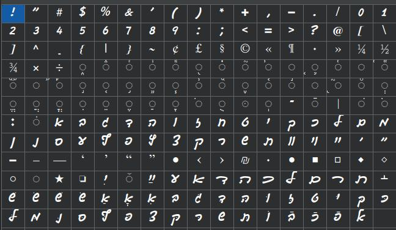

# hwocr — OCR for Hebrew handwriting-style fonts

Proof of concept for recognizing Hebrew text set in a computer font that imitates
handwriting. Works fully offline, on CPU, with no pretrained models to download.

Recognition is not perfect — it especially errs on spaces — but it's better than nothing.

## Font samples

**Gveret Levin Alef Alef Alef** — `fonts/Gveret Levin Alef Alef Alef.ttf`


**Guttman Yad-Brush** — `fonts/guttman-yad-brush.ttf`



## Quick start

### 1. Install dependencies

```bash
uv sync        # or: pip install -r requirements.txt
```

### 2. Download the model files

Download all 8 files and place them into the `models/` directory of the project
(on the same level as `fonts/`, `hwocr/`, etc.):

1. https://drive.google.com/file/d/1AE0zWAAsLuDegk74EpGNIEX9zHilnbpW/view?usp=sharing
2. https://drive.google.com/file/d/1sIPL8GAp-XVeLjfgd-HlBV_Bhllj9Hv8/view?usp=sharing
3. https://drive.google.com/file/d/1I2O82lsYI0GRep-lBsQKg06k38nKKXfW/view?usp=sharing
4. https://drive.google.com/file/d/1PdAZGHZEsfAbEmA1_Ov3Za-a8mRAyBUP/view?usp=sharing
5. https://drive.google.com/file/d/1CFFJ_er9UPn4E_yw8aQgaDMinrD09LuF/view?usp=sharing
6. https://drive.google.com/file/d/1GCqJ0kPo2uKkFEsj-agEZqzF9W5qEUdr/view?usp=sharing
7. https://drive.google.com/file/d/1fCP4sr8q75QHcAjTEdQjcQx31n_6w4-M/view?usp=sharing
8. https://drive.google.com/file/d/1pdvnE92FRHm1e9xXfwLyo8LR5MRTP9O1/view?usp=sharing

### 3. Recognize your own file

```bash
python3 -m hwocr.cli recognize --image page.png --out-image runs/annotated.png
```

### 4. Web interface

Drag & drop images + bounding-box editor + demo:

```bash
python3 -m hwocr.cli serve --port 8009     # or: bash run_server.sh
```

Then open **http://127.0.0.1:8009** in your browser. The model is loaded into memory at
startup, so restart the server after retraining to pick up a new checkpoint.

---

Full pipeline (self-test, dataset generation, training, evaluation, metrics, limitations,
UI details) — see [full_doc.md](full_doc.md).
